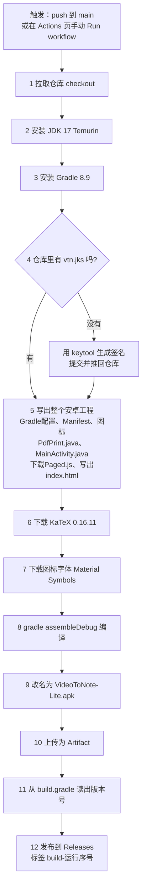

# VideoToNote 视频笔记 App

把 B 站视频转换成结构化的 Markdown 学习笔记（支持公式和截图），可以批量生成，也可以导出排版好的 PDF。

---

## 功能

### 生成笔记
- 粘贴 B 站视频链接，生成一篇 Markdown 笔记，支持 KaTeX 公式和视频截图。
- **多 P 视频**：自动列出所有分 P，点整行即可选中（带动效），可以批量生成。已经生成过的会标"已生成"。
- **合集**：粘贴合集里任意一集的链接，自动列出整个合集，可以全选、只选没做过的、批量生成。
  - 合集里某一集本身是多 P 的，只生成它的 P1。
  - 按顺序逐集生成，出错时停在出错的那一集，已经完成的会保留；App 在后台时，完成后发通知。
- "已生成"的判断依据：笔记库里已经有同一个 BV 号的笔记。

### 阅读笔记
- 单栏阅读，带搜索和目录。
- 笔记库支持分类管理，每篇笔记都有"⋮"菜单。

### 导出
- **Markdown**：导出原始文本。
- **PDF**（1.8.6 起）：
  - 入口：笔记详情页工具栏，或笔记库"⋮"菜单 → 导出 PDF。
  - 可选项：排版（单栏 / **双栏教材式**）、字号（小 / 中 / 大）、截图（保留 / 不要）、页边距（标准 / 窄）。设置会被记住。
  - A4 纸张，用 Paged.js 分页，每页底部有页码；截图、公式、表格不会被切到两页或两栏。
  - App 直接写出 PDF 文件，不弹系统打印界面，保存到 `下载/VideoToNote`。PDF 里是真文字，可以选中和搜索。
  - 直接生成失败时，可以改用系统打印作为备用方案。

---

## 技术结构

| 部分 | 说明 |
|---|---|
| 界面 | Android WebView + HTML/JS，由 `build.yml` 里的脚本生成 |
| 公式 | KaTeX |
| PDF 分页 | [Paged.js](https://pagedjs.org) 0.4.3（`paged.polyfill.js`），编译时从 unpkg 下载，失败时改用 jsDelivr，打包进 App 后离线使用 |
| PDF 写出 | `PdfPrint.java`（放在 `android.print` 包下），调用 WebView 的 PDF 接口静默生成 |
| 本地存储 | localStorage；`vtn_pdf` 用来保存 PDF 设置（`vtn_cols` 已废弃） |

---

## 编译与发布（GitHub Actions 工作流程）

整个项目只有一个文件：`.github/workflows/build.yml`。仓库里**不存放**任何源码，每次编译时由工作流现场把整个安卓工程"写出来"，再编译成 APK。仓库里另外只需要一个签名文件 `vtn.jks`。

### 总览

### 触发条件与运行环境

| 项目 | 设置 | 说明 |
|---|---|---|
| 触发 | `push` 到 `main` 分支；`workflow_dispatch` | 上传新的 `build.yml` 本身就是一次 push，会自动开始编译；也可以在 Actions 页面点 **Run workflow** 手动重跑 |
| 权限 | `contents: write` | 第 4 步要把签名文件推回仓库，第 12 步要创建 Release，都需要写权限 |
| 运行机器 | `ubuntu-latest` | GitHub 提供的云端 Linux，用完即销毁，所以每次都要重新下载依赖 |

### 逐步说明

**第 1–3 步：准备环境**
- `actions/checkout@v4`：把仓库内容（`build.yml` 和 `vtn.jks`）拉到机器上。
- `actions/setup-java@v4`：安装 Temurin JDK **17**（与 `app/build.gradle` 里的 `JavaVersion.VERSION_17` 对应）。
- `gradle/actions/setup-gradle@v4`：安装 Gradle **8.9**。工程里没有 Gradle Wrapper，直接用这个版本的 `gradle` 命令。

**第 4 步：Ensure fixed signing key（固定签名）**
- 仓库里已有 `vtn.jks` 时，这一步什么也不做。
- 没有时，用 `keytool` 生成一个：RSA 2048 位，别名 `vtn`，有效期 20000 天，证书名 `CN=VideoNote`；然后以 `github-actions` 身份提交并 `git push` 回仓库。
- 用 Actions 自带令牌推送的提交**不会再次触发**工作流，所以不会无限循环。
- 为什么重要：安卓只允许**签名相同**的新版本覆盖安装。`vtn.jks` 一旦删掉，下次会生成一把新钥匙，新 APK 就装不上，只能先卸载旧版，**笔记数据会丢**。

**第 5 步：Write project files（写出整个工程）**

用一连串 `cat > 文件 <<'VTN_EOF' … VTN_EOF` 把文件逐个写出来。结束标记加了单引号，所以里面的 `$`、反引号等内容**原样写入**，不会被 Shell 替换。按顺序写出：

| 文件 | 内容要点 |
|---|---|
| `settings.gradle` | 工程名 `VideoToNoteLite`；依赖仓库 google、mavenCentral |
| `build.gradle` | Android Gradle 插件 **8.5.2** |
| `gradle.properties` | 编译内存 `-Xmx2g`；启用 AndroidX |
| `app/build.gradle` | 包名 `com.vtn.lite`；compileSdk / targetSdk 34，minSdk 24（安卓 7.0 起）；**versionCode 44、versionName "1.8.7"**；debug 签名指向 `../vtn.jks` |
| `AndroidManifest.xml` | 权限：联网、前台服务（数据同步类）、通知、唤醒锁；`MainActivity` 为 singleTask，并能接收别的 App "分享"过来的文字（用来接收 B 站分享链接）；后台保活服务 `KeepService` |
| 图标 | `ic_launcher.png`、`ic_launcher_fg.png` 以 base64 写在 yml 里，用 `base64 -d` 还原；另有自适应图标的背景色和配置 xml |
| `android/print/PdfPrint.java` | 静默写 PDF 的工具类，必须放在 `android.print` 包下才能调用打印接口 |
| `com/vtn/lite/MainActivity.java` | 原生部分：WebView 容器、B 站登录 Cookie、网络请求、语音转写上传、视频截帧、文件读写、通知、PDF 生成等，通过 `Native` / `PdfBridge` 两个接口提供给网页调用 |
| `assets/paged.polyfill.js` | **不是写出来的，而是下载的**：先从 unpkg 下载 Paged.js 0.4.3，失败就换 jsDelivr（都带 3 次重试）；最后用 `test -s` 检查文件不为空，否则这一步直接失败 |
| `assets/index.html` | 全部界面和业务逻辑（约 2900 行 HTML/CSS/JS），是 yml 里最长的一段 |

**第 6 步：Fetch KaTeX**

从 npm 官方源下载 KaTeX **0.16.11** 的压缩包，把 `katex.min.js`、`katex.min.css` 和 `fonts/` 复制到 `assets/katex/`，用于离线渲染公式。

**第 7 步：Fetch Material Symbols**

从 BeerCSS 5.0.3 的 npm 包里取出 `material-symbols-rounded.woff2`，放到 `assets/ms/`，作为界面图标字体（网页里另有加载失败时的备用处理）。

**第 8–10 步：编译与产物**
- `gradle assembleDebug --no-daemon`：编译 **debug 版** APK，但签名用的是固定的 `vtn.jks`，不是每台机器各自的默认调试签名。
- 把 `app-debug.apk` 复制为 `VideoToNote-Lite.apk`。
- `actions/upload-artifact@v4` 以 `VideoToNote-Lite` 为名上传。在这次运行的页面底部 **Artifacts** 里能下载（下载下来是 zip，要先解压）。

**第 11–12 步：发布 Release**
- 用 `grep` 从 `build.gradle` 里读出 `versionName`（如 `1.8.7`）。
- `softprops/action-gh-release@v2` 创建 Release：标签为 `build-运行序号`，标题如"视频笔记精简版 v1.8.7（第 N 版）"，附件就是 APK。
- **手机上最方便的下载方式**：仓库首页右侧 Releases → 最新一条 → 直接点 `VideoToNote-Lite.apk`，不用解压。

### 发新版本的操作步骤
1. 打开仓库的 `.github/workflows` 文件夹。
2. 点 **Add file → Upload files**，用新的 `build.yml` 覆盖原文件，提交到 `main`。
3. **不要删除 `vtn.jks`**。
4. 到 **Actions** 页看运行状态，大约几分钟；全部步骤打勾即成功。
5. 到 **Releases** 下载 APK，直接覆盖安装，原有笔记保留。

### 编译失败时先看哪一步

| 失败的步骤 | 常见原因 |
|---|---|
| Write project files | Paged.js 两个下载地址都失败（`test -s` 报错）；或 yml 缩进被破坏，导致某个 `VTN_EOF` 没被识别 |
| Fetch KaTeX / Material Symbols | npm 源临时不可用，重跑一次通常就好 |
| Build APK | Java 代码写错（如 `PdfPrint.java`）、Gradle 依赖下载失败；看日志里第一条 `error:` |
| Publish to Releases | 仓库没给写权限；可到 Settings → Actions → General 把 Workflow permissions 设为 Read and write |

### 修改 `build.yml` 时的规则
- **第 5 步的长脚本里不能出现 `${{ }}`**：GitHub 会先把它当表达式替换，再交给 Shell，网页代码就被改坏了。只有第 12 步的 Release 标题里允许使用（那里本来就要用运行序号和版本号）。
- 被写出的文件内容里**不能有单独一行的 `VTN_EOF`**，否则文件会被提前截断。
- 所有写出的内容都要保持统一缩进（比 `run: |` 多一级），YAML 会把这层缩进去掉后再交给 Shell。
- `name: Build APK` 在文件里只能出现 2 次（工作流名和编译步骤名）。
- 每次发版：`versionCode` 加 1，`versionName` 改成新版本号，两处都在 `app/build.gradle` 那段里。
- 不要修改已有的 localStorage 键名，否则装新版后读不到旧数据。

---

## 已知限制
- 合集列表依赖 B 站接口里的合集字段，接口变化后可能失效。
- Paged.js 同时处理"分栏 + 分页"时，个别页面的右栏可能会空着。
- PDF 使用手机自带的中文字体，不同机型的显示效果可能略有不同。
- 很长的笔记导出 PDF 时可能需要十几秒，超过 150 秒会提示超时。

---

## 版本记录

| 版本 | versionCode | 内容 |
|---|---|---|
| 1.8.7 | 44 | Paged.js 分页 + 静默导出 PDF；修复设置面板选中按钮变成空白 |
| 1.8.6 | 43 | 新增导出 PDF（单栏 / 双栏）；去掉阅读页的分栏 |
| 1.8.5 | 42 | 阅读页双栏（已在 1.8.6 撤销） |
| 1.8.4 | 41 | 合集批量生成 |
| 1.8.3 | 40 | 多 P 选择改成整行点选加动效 |

---

## 代码结构（2.8.0 起）

| 位置 | 作用 |
|---|---|
| `web/index.html` | 页面骨架和样式，主脚本位置只放占位符 `/*@@APP_JS@@*/` |
| `web/js/*.js` | 主脚本按功能拆成 33 个文件，按文件名顺序拼接 |
| `web/assemble.py` | 编译时把 `web/js/*.js` 拼回 `index.html`，运行效果与单文件一样 |
| `tools/check.py` | 编译前检查：语法、新增空 `catch`、直接读写 `localStorage`、顶层同名函数，超标就让编译失败 |
| `.github/uitest.py` | 模拟器 UI 测试，Build APK 成功后自动运行，任一断言失败就变红 |

约定：不写空 `catch (e) {}`，改写 `catch (e) { __err(e, "位置") }`（进入 设置 → 关于 → 错误日志）；本地数据用 `Store.get/set/del/json`。根目录旧 `build.yml` 已删除。
