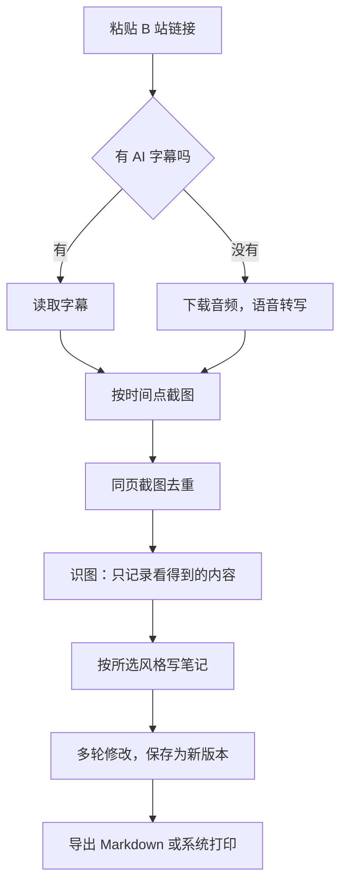

# VideoToNote-Lite（视频笔记）

把 B 站网课视频自动整理成**教辅风格的图文笔记**的安卓 App。自用，主要在平板上使用。

当前版本：**1.7.4**

## 主要功能
- **一键生成**：粘贴 B 站链接、BV 号或分享文字，自动生成 Markdown 笔记
- **字幕优先**：有 AI 字幕时直接读取；没有字幕时用硅基流动 SenseVoice 语音转写
- **截图识图**：自动截取 PPT 题目和手写板书，识图后插入笔记。只记录画面上能看到的内容，不估读、不推断
- **同页去重**：同一页 PPT 只保留最干净的一张（放在正文里）和批注最全的一张（放在"其余课堂截图"），中间截图自动删除，节省空间
- **三种笔记风格**
  - 教辅模式：内容提要、类型、方法、例题、解析、答案、反思、变式、总结、易错点、强化训练，各科通用
  - 简要摘要
  - 详细逐段
- **我的要求**：可以附加自己的要求（如"标出高考考点""末尾出 3 道自测题"），以后每次生成都会用上
- **公式和表格**：公式用 KaTeX 渲染，支持表格
- **多轮修改**：写修改意见后，AI 基于已保存的材料重写，不需要重新截图；每次修改保存为新版本（第 1 版、第 2 版…）
- **过程可视化**：生成时显示流程节点、请求数、总进度和计时，可以随时暂停或继续；中断后可以"继续生成"
- **后台运行**：切到后台也会继续生成
- **个性化**：浅色、深色或跟随系统；4 种主题色；可以上传自定义背景图

## 工作流程

## 安装
1. 打开本仓库的 **Releases**，下载最新的 `VideoToNote-Lite.apk`
2. 在平板上安装。签名固定，新版本可以直接覆盖安装，笔记和设置都会保留

> 安卓只允许版本号更高的安装包覆盖安装。如果想退回旧界面，要先在新版本里改回旧代码，再升版本号重新编译，不能直接装旧的 APK。

## 使用前设置
在 App 的"设置"页填写：

| 设置项 | 说明 |
|---|---|
| 接口地址、模型名、API Key | 生成笔记用，支持 OpenAI 兼容接口（如 DeepSeek） |
| 截图识图 / 语音转写 | 识图模型和硅基流动 API Key；截图间隔建议 60 秒 |
| B 站账号 | AI 字幕通常要登录后才能读取 |

设置页还有两个按钮：
- **测试连接**：检查 API 是否能正常调用
- **查询余额**：查看 API 账户还剩多少

> API Key 只保存在本机，不要写进代码或提交到仓库。

## 笔记页菜单
| 菜单项 | 作用 |
|---|---|
| AI 输入 | 查看发给 AI 的全部材料 |
| 导出 Markdown | 导出 .md 文件，图片直接嵌入，换设备也能打开 |
| 系统打印 | 用系统打印另存为 PDF |
| 分享 / 复制全文 | 分享或复制笔记源码 |
| 保存字幕 .srt | 导出字幕文件 |
| 查看源码 | 直接编辑 Markdown 源码 |

材料页还有"一键复制反馈"：把运行日志和设置摘要打包复制，方便排查问题。

## 编译
用 GitHub Actions 自动编译，配置文件是 `.github/workflows/build.yml`，App 的全部代码都写在这个文件里。

1. 进入 `.github/workflows` 文件夹，点 **Add file → Upload files**，上传新的 `build.yml` 覆盖旧文件
2. Actions 显示绿色对勾后，到 Releases 下载 APK

注意事项：
- 文件夹名必须是 `.github`，前面有个点；`workflows` 文件夹里只放 `build.yml` 一个文件
- 用上传覆盖，不要把内容粘贴进网页编辑器，避免粘贴两遍
- 签名文件 `vtn.jks` 不要删除，否则新版本无法覆盖安装

## 已知限制
- 不提供"导出 PDF"按钮，需要 PDF 请用"系统打印 → 另存为 PDF"
- 不支持导出 DOCX
- 旧笔记里以前留下的多余截图不会自动清理

## 版本历史
| 版本 | 内容 |
|---|---|
| 1.3 | 截图识图、无字幕语音转写 |
| 1.4 | KaTeX 公式、AI 输入页、多轮修改；表格显示 |
| 1.5 | 系统打印、图文 MD；后台运行、查询余额、粘贴键改用原生剪贴板 |
| 1.6.0 | 新增教辅模式；修复公式 `$$` 显示问题；识图不估读 |
| 1.6.1 | 教辅模式规则改为各科通用 |
| 1.6.2 | 自动读取版本号、更新日志、一键复制反馈、同页截图取舍 |
| 1.6.3 | 暂停/继续、生成过程可视化、仿 iOS 界面 |
| 1.6.4 | 自动删除同页中间截图 |
| 1.6.5 | "保存笔记"和"导出图文 MD"合并为"导出 Markdown"；去掉细进度条 |
| 1.6.6 | 链接为空时直接提示；修复报错时进度误跳 |
| 1.6.7 | 自定义背景图；侧边栏去掉分割线 |
| 1.6.8 | 去掉毛玻璃效果 |
| 1.6.9–1.7.2 | Framework7 界面试验（已放弃） |
| 1.7.3 | 恢复 1.6.8 的界面 |
| 1.7.4 | 新应用图标：绿色"笔"字加播放键 |
